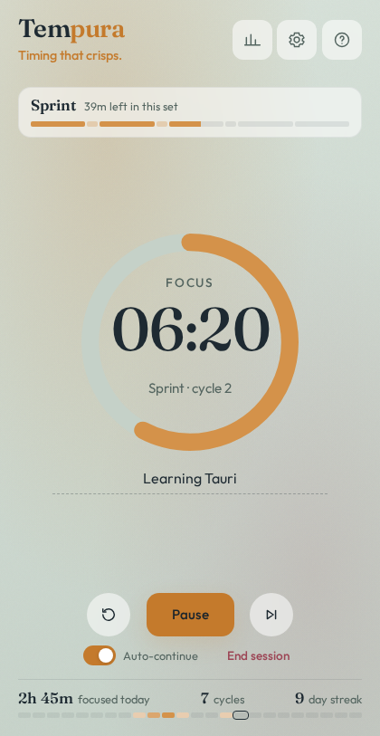

# Tempura

<p align="center">
  
</p>

<p align="center">
  <a href="https://github.com/vcostin/tempura/actions/workflows/ci.yml"></a>
  <a href="https://github.com/vcostin/tempura/releases/latest"></a>
  <a href="LICENSE"></a>
</p>

Premium focus-rhythm timer for desktop — structured intervals, flexible flow techniques, local-first, tray-native.

Timing matters. Tempura stays calm, polished, and entirely on your machine: **no accounts, no cloud, no sync.**

**[Download the latest desktop build](https://vcostin.github.io/tempura/)** for Linux, Windows, or macOS.

Windows SmartScreen and macOS Gatekeeper may warn on first open (unsigned builds).

<p align="center">
  
</p>

## Develop

[Deno](https://deno.land/) 2.x and Rust stable ([Tauri prerequisites](https://v2.tauri.app/start/prerequisites/)):

```bash
deno install
deno task tauri:dev
```

`deno task website:shots` renders the website's screenshots (`website/shots/`) from the app with sample data.

If Ctrl+C leaves Vite on port 1420, `deno task free-dev-port` stops that leftover only (not whatever else might be bound there). `tauri:dev` does the same check first.

## Features

- **Techniques**: Classic (25/5), Sprint (15/3), Deep (50/10), 52/17, Ultradian (90/20), Flowtime, Hybrid, plus your own; the technique sheet shows each one's rhythm side by side
- **Session**: countdown owned by the native side (correct while hidden / across sleep)
- **Tray**: close the window to hide; quit from the tray or Settings
- **Notifications**: phase complete; optional sound and halfway tick
- **Stats**: any day, week, month, year or all time, compared with the period before; when you focus (weekday × hour), which rhythm suits you, what the time went to; CSV/JSON export. Today's focus, hour by hour, sits under the timer
- **Themes**, 15 languages (including right-to-left), and optional updates from GitHub Releases (Help & About)

### Keyboard

| Key | Action |
|-----|--------|
| `Space` | Start / pause / resume |
| `S` | Skip phase |
| `,` or `Ctrl+,` | Settings |
| `Esc` | Back / hide to tray |
| `?` | All keyboard shortcuts |

Keyboard and dialogs are first-class. Screen readers on the timer UI should work; tray and OS notifications depend on the OS.

## Privacy

Presets, settings, and history stay in local SQLite. No accounts, no cloud, no sync. Optional update checks ask GitHub for the latest release and, if you update, download the installer from there.

## Docs

- [Releasing](docs/releasing.md) — cutting a desktop release and updater signing
- [Security](docs/security.md) — desktop trust model and audit notes

## License

[MIT](LICENSE) © 2026 Vadim Costin

App icon shrimp mark adapted from [Twemoji](https://github.com/jdecked/twemoji) (CC-BY 4.0); see `assets/ICON-ATTRIBUTION.txt`.
